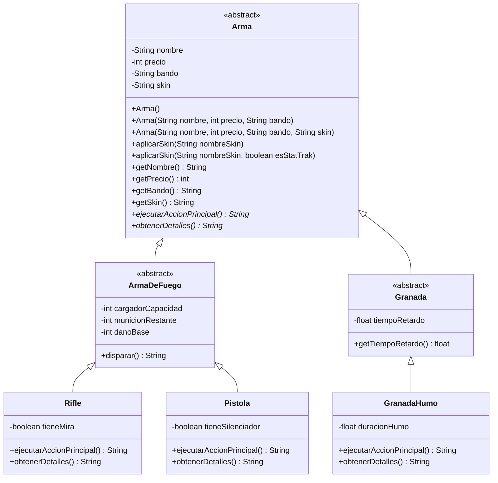

# Taller de GIT + Práctica POO & API REST (CS2)

**Asignatura:** CYT646 — Lenguaje de Programación 3  
**Edición:** 2026  
**Alumno:** Ariel Gaona  
**Dominio seleccionado:** Opción B — Counter-Strike 2  
**Licencia:** Apache License 2.0  

---

## 📌 Descripción del Proyecto

Este repositorio contiene la implementación de una API REST desarrollada con **Spring Boot 3** y **Java 21**, utilizando **Maven** y **Spring Web**.

El proyecto modela diferentes tipos de armas del videojuego **Counter-Strike 2**, aplicando los principales conceptos de Programación Orientada a Objetos trabajados durante la asignatura.

### Conceptos de POO aplicados

* **Encapsulamiento y ocultamiento de información:** los atributos del dominio permanecen ocultos mediante modificadores de acceso como `private`. El estado de los objetos se modifica mediante métodos de dominio.
* **Herencia:** se utiliza una jerarquía de clases partiendo de la clase abstracta `Arma`.
* **Generalización:** `ArmaDeFuego` y `Granada` representan especializaciones intermedias del dominio.
* **Sobrecarga (Overloading):** se implementaron constructores múltiples y métodos sobrecargados (como la gestión de skins y acabados) con el mismo nombre pero distintas firmas.
* **Sobrescritura (Overriding):** las clases concretas implementan el comportamiento definido por la clase base.
* **Polimorfismo:** los objetos pueden ser tratados mediante el tipo general `Arma`, permitiendo solicitar su comportamiento sin depender de comprobaciones del tipo concreto.
* **Abstracción:** `Arma` define comportamientos comunes mediante métodos abstractos que deben ser implementados por las clases concretas.

---

## 🛠️ Tecnologías

* **Java 21**
* **Spring Boot 3**
* **Spring Web**
* **Maven**
* **Git / GitHub**
* **Mermaid** para el diagrama de clases

---

## 📁 Estructura principal

```text
src/
└── main/
    └── java/
        └── py/
            └── edu/
                └── uc/
                    └── lp3/
                        ├── ag/
                        │   └── cs2/
                        │       ├── model/
                        │       │   ├── Arma.java
                        │       │   ├── ArmaDeFuego.java
                        │       │   ├── Granada.java
                        │       │   ├── Rifle.java
                        │       │   ├── Pistola.java
                        │       │   └── GranadaHumo.java
                        │       └── controller/
                        │           ├──ArmaController.java
                                    ├──IndexController.java
                                    └──TiendaController.java
                        └── web/
```

---

## ▶️ Ejecución del proyecto

### Requisitos

* Java JDK 21
* Maven incluido mediante Maven Wrapper

### Compilar

En Linux/macOS:
```bash
./mvnw -q compile
```

En Windows:
```bash
mvnw.cmd -q compile
```

### Ejecutar la aplicación

En Linux/macOS:
```bash
./mvnw spring-boot:run
```

En Windows:
```bash
mvnw.cmd spring-boot:run
```

Una vez iniciada la aplicación, el servidor queda disponible en:
```text
http://localhost:8080
```

---

## 🌐 API REST

### `GET /`
Endpoint utilizado para comprobar que el servicio está funcionando correctamente.

### Controller de construcción
La API cuenta con controllers que reciben parámetros mediante `@RequestParam` para construir dinámicamente instancias de las armas aplicando constructores simples y sobrecargados. La respuesta se serializa automáticamente en formato **JSON**.

---

## 📐 Diagrama de Clases

El siguiente diagrama representa el modelo de clases desarrollado para el dominio de **Counter-Strike 2**:



---

## ⚙️ Diferencias Clave: Sobrecarga vs. Sobrescritura

* **Sobrecarga (Overloading):** Se aplicó tanto en constructores (`Arma()`, `Arma(nombre, precio, bando)`, `Arma(nombre, precio, bando, skin)`) como en métodos de dominio orientados a la temática del juego (`aplicarSkin(String)` vs `aplicarSkin(String, boolean)` para acabados StatTrak™). Esto permite inicializar y manipular objetos con flexibilidad adaptándose a diferentes firmas en tiempo de compilación.
* **Sobrescritura (Overriding):** Se implementó mediante el uso de anotaciones `@Override` en las clases hijas (`Rifle`, `Pistola`, `GranadaHumo`), redefiniendo los métodos abstractos heredados de la clase base `Arma` (`ejecutarAccionPrincipal()` y `obtenerDetalles()`) para proveer comportamientos polimórficos específicos sin requerir sentencias `if/else` externas.

---

## 📜 Licencia

Este proyecto se distribuye bajo los términos de la **Licencia Apache 2.0**. Consulta el archivo `LICENSE` para más información.