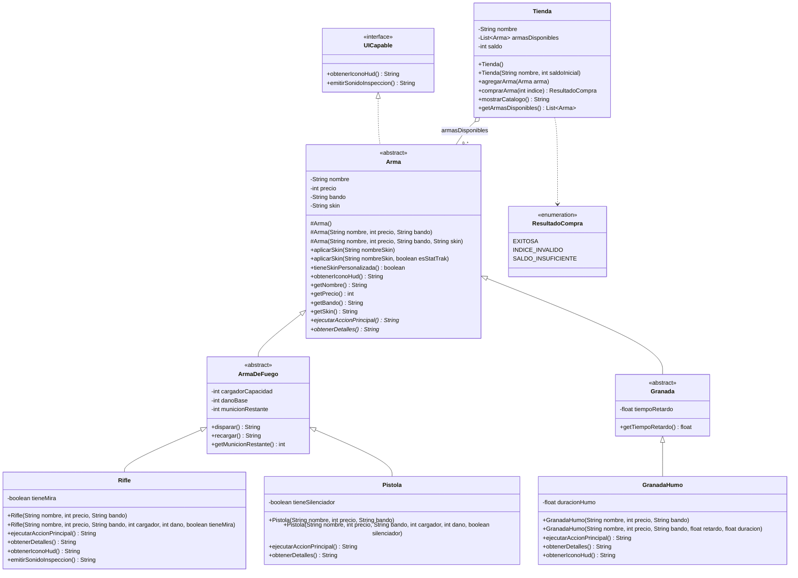

# Taller de GIT + Práctica POO & API REST (CS2)

**Asignatura:** CYT646 — Lenguaje de Programación 3  
**Edición:** 2026  
**Alumno:** Ariel Gaona  
**Dominio seleccionado:** Opción B — Counter-Strike 2  
**Licencia:** Apache License 2.0  

### 🔗 Commit de la entrega (Ejercicio POO-06)

https://github.com/ferue/agaona-taller-git-2026/commit/4fae9d253e3a9f7961eee31320f8a42ea60ff53a

Este commit tiene la solución completa: el código, los tests, este README y la bitácora. El commit posterior solo agrega este enlace.

---

## 📌 Descripción del Proyecto

Este repositorio contiene una API REST desarrollada con **Spring Boot 4.1** y **Java 21**, usando **Maven** y **Spring Web MVC**.

El proyecto modela armas y la tienda (buy menu) del videojuego **Counter-Strike 2**, aplicando los conceptos de Programación Orientada a Objetos trabajados en la asignatura.

### Conceptos de POO aplicados

* **Encapsulamiento y ocultamiento de información:** todos los atributos son `private` y no hay setters. `nombre`, `precio` y `bando` son `final`; la skin solo cambia mediante `aplicarSkin(...)` y la munición solo con `disparar()` / `recargar()`.
* **Invariantes:** los constructores validan los datos y lanzan `IllegalArgumentException` si son inválidos (precio negativo, nombre vacío, cargador ≤ 0, etc.). La tienda nunca queda con saldo negativo y su catálogo se expone como lista de solo lectura.
* **Herencia y generalización:** `Arma` (abstracta) → `ArmaDeFuego` / `Granada` (abstractas) → `Rifle`, `Pistola`, `GranadaHumo`.
* **Sobrecarga (overloading):** constructores con distintas firmas en `Arma`, `Rifle`, `Pistola`, `GranadaHumo` y `Tienda`; métodos `aplicarSkin(String)` / `aplicarSkin(String, boolean)` y `FabricaArmas.crear(...)` con dos firmas.
* **Sobrescritura (overriding):** las clases concretas implementan `ejecutarAccionPrincipal()` y `obtenerDetalles()` con `@Override`; `Rifle` y `GranadaHumo` redefinen `obtenerIconoHud()` y `Rifle` redefine el método `default` `emitirSonidoInspeccion()` de `UICapable`.
* **Polimorfismo:** los controladores trabajan con `Arma` o `UICapable` sin preguntar por la clase concreta (`/api/armas/polimorfismo`, `/ui/{nombre}`).
* **Abstracción:** `Arma`, `ArmaDeFuego` y `Granada` son abstractas; `UICapable` es una interfaz con un método abstracto y uno `default`.

---

## 🛠️ Tecnologías

* **Java 21**
* **Spring Boot 4.1** (Spring Web MVC)
* **Maven** (con Maven Wrapper)
* **JUnit 5**
* **Git / GitHub**
* **Mermaid** para el diagrama de clases

---

## 📁 Estructura principal

```text
cs2/
├── pom.xml
└── src/
    ├── main/java/py/edu/uc/lp3/ag/cs2/
    │   ├── Cs2Application.java
    │   ├── domain/                      ← modelo de dominio (POO)
    │   │   ├── UICapable.java
    │   │   ├── Arma.java
    │   │   ├── ArmaDeFuego.java
    │   │   ├── Granada.java
    │   │   ├── Rifle.java
    │   │   ├── Pistola.java
    │   │   ├── GranadaHumo.java
    │   │   ├── Tienda.java
    │   │   └── ResultadoCompra.java
    │   ├── service/
    │   │   └── FabricaArmas.java        ← crea armas a partir del "tipo"
    │   └── rest/                        ← capa web
    │       ├── ManejadorErrores.java    ← traduce excepciones a 400 / 404
    │       ├── RecursoNoEncontradoException.java
    │       ├── controller/
    │       │   ├── IndexController.java
    │       │   ├── ArmaController.java
    │       │   ├── TiendaController.java
    │       │   └── UIController.java
    │       └── response/
    │           ├── ArmaResponse.java
    │           ├── ErrorResponse.java
    │           └── UIElementResponse.java
    └── test/java/py/edu/uc/lp3/ag/cs2/
        ├── Cs2ApplicationTests.java
        ├── domain/
        │   ├── ArmaTest.java
        │   ├── ArmaDeFuegoTest.java
        │   └── TiendaTest.java
        └── rest/controller/
            └── ControladoresTest.java
```

---

## ▶️ Ejecución del proyecto

### Requisitos

* Java JDK 21
* Maven incluido mediante Maven Wrapper (no hace falta instalarlo)

Todos los comandos se ejecutan dentro de la carpeta `cs2/`.

### Compilar

```bash
./mvnw -q compile        # Linux / macOS
mvnw.cmd -q compile      # Windows
```

### Ejecutar los tests

```bash
./mvnw test              # Linux / macOS
mvnw.cmd test            # Windows
```

### Ejecutar la aplicación

```bash
./mvnw spring-boot:run   # Linux / macOS
mvnw.cmd spring-boot:run # Windows
```

El servidor queda disponible en `http://localhost:8080`.

---

## 🌐 API REST

Errores: los datos inválidos responden **400** y los recursos inexistentes **404**, siempre con un JSON de la forma:

```json
{ "status": 404, "error": "Not Found", "mensaje": "Tienda no encontrada: tienda-9" }
```

### `GET /`
Comprueba que el servicio funciona y lista los endpoints disponibles.

### `GET /api/armas/probar`
Construye un arma y ejecuta su acción principal. Parámetros (todos opcionales): `tipo` (`rifle`, `pistola`, `granada-humo`), `nombre`, `precio`, `bando`, `skin`, `statTrak`.

Si llega `skin` se usa `aplicarSkin(String)`; si además llega `statTrak` se usa la sobrecarga `aplicarSkin(String, boolean)`.

```bash
curl "http://localhost:8080/api/armas/probar?tipo=rifle&nombre=AK-47&precio=2700&bando=T&skin=Asiimov&statTrak=true"
```
```json
{
  "arma": {
    "tipo": "Rifle", "nombre": "AK-47", "precio": 2700, "bando": "T",
    "skin": "StatTrak™ Asiimov",
    "detalles": "Rifle AK-47 | Daño: 36 | Cargador: 30",
    "iconoHud": "ui/hud/icons/rifle.png"
  },
  "resultadoAccion": "¡PUM! Disparo efectuado con AK-47. Munición restante: 29"
}
```

Con `precio=-100` o `tipo=escopeta` responde **400**.

### `GET /api/armas/rafaga`
Dispara `disparos` veces (1 a 100) con un arma de fuego y luego recarga, mostrando cómo cambia la munición.

```bash
curl "http://localhost:8080/api/armas/rafaga?tipo=pistola&disparos=3"
```
Respuesta (resumida): `disparos` con 3 mensajes (munición 11, 10, 9), `municionAntesDeRecargar: 9`, `recarga: "Recargando PISTOLA... Munición: 12/12"`, `municionFinal: 12`.

### `GET /api/armas/polimorfismo`
Recorre una `List<Arma>` (rifle, pistola y granada de humo) y llama a los mismos métodos en cada una; cada clase responde con su propia sobrescritura.

### Tienda

| Método y ruta | Descripción | Respuestas |
|---|---|---|
| `POST /tienda?nombre=CT&saldo=5000` | Crea una tienda | 201 |
| `POST /tienda/{id}/agregar-arma?tipo=rifle&nombre=M4A1-S&precio=2900&bando=CT` | Agrega un arma (opcionales: `cargadorCapacidad`, `danoBase`, `atributoEspecial`) | 201 · 400 tipo/datos inválidos · 404 |
| `GET /tienda/{id}/catalogo` | Lista las armas y el saldo | 200 · 404 |
| `POST /tienda/{id}/comprar?indiceArma=0` | Compra el arma de esa posición | 200 · 400 índice inválido · 409 saldo insuficiente · 404 |

```bash
curl -X POST "http://localhost:8080/tienda?nombre=CT&saldo=5000"
# {"id":"tienda-0","nombre":"CT","saldo":5000,"armasEnInventario":0}

curl -X POST "http://localhost:8080/tienda/tienda-0/agregar-arma?tipo=rifle&nombre=M4A1-S&precio=2900&bando=CT&cargadorCapacidad=25&danoBase=38&atributoEspecial=true"

curl -X POST "http://localhost:8080/tienda/tienda-0/comprar?indiceArma=0"
# {"tienda":"CT","resultado":"EXITOSA","mensaje":"Compra realizada","saldoRestante":2100,"armasRestantes":0}
```

### `GET /ui/{nombre}`
Devuelve el elemento de HUD de un arma (`ak47`/`rifle`, `usp`/`pistola`, `smoke`/`humo`). El controlador solo conoce la interfaz `UICapable`. Un nombre inexistente responde **404**.

```bash
curl "http://localhost:8080/ui/ak47"
# {"tipo":"Rifle","imagen":"ui/hud/icons/rifle.png","posicion":"HUD_SLOT_PRINCIPAL",
#  "sonido":"clack-clack_metalico_rifle.wav","velocidad":200.0,"mensaje":"Cargado correctamente para CS2"}
```

---

## 📐 Diagrama de Clases



---

## ⚙️ Qué cambió con la sobrecarga y con la sobrescritura

### Sobrecarga (overloading): qué se agregó y dónde

| Clase | Qué se agregó | Firmas |
|---|---|---|
| `Arma` | Tres constructores encadenados con `this(...)`. Solo el más completo valida, así que todas las firmas dejan el objeto en un estado válido | `Arma()` · `Arma(nombre, precio, bando)` · `Arma(nombre, precio, bando, skin)` |
| `Arma` | Sobrecarga de un mensaje del dominio: aplicar una skin común o una StatTrak™ | `aplicarSkin(String)` · `aplicarSkin(String, boolean)` |
| `Rifle`, `Pistola`, `GranadaHumo` | Un constructor simple con los valores estándar de CS2 y otro completo. Ambos llaman a `super(...)` | p. ej. `Rifle(nombre, precio, bando)` · `Rifle(nombre, precio, bando, cargador, daño, tieneMira)` |
| `Tienda` | Un constructor simple con el dinero inicial de CS2 ($800) y otro con nombre y saldo | `Tienda()` · `Tienda(nombre, saldoInicial)` |
| `FabricaArmas` | Creación por tipo con los valores estándar o con todos los atributos | `crear(tipo, nombre, precio, bando)` · `crear(tipo, nombre, precio, bando, cargador, daño, especial)` |

Ejemplo: `new Rifle("AK-47", 2700, "T")` crea un rifle estándar y `new Rifle("AK-47", 2700, "T", 30, 36, true)` define todos los atributos; `aplicarSkin("Redline")` deja `Redline` y `aplicarSkin("Asiimov", true)` deja `StatTrak™ Asiimov`.

### Sobrescritura (overriding): qué se agregó y dónde

| Método | Declarado en | Sobrescrito en | Qué hace cada hija |
|---|---|---|---|
| `ejecutarAccionPrincipal()` | `Arma` (abstracto) | `Rifle`, `Pistola`, `GranadaHumo` | El rifle dispara y avisa si usa mira; la pistola dispara e indica si está silenciada; la granada despliega humo |
| `obtenerDetalles()` | `Arma` (abstracto) | `Rifle`, `Pistola`, `GranadaHumo` | Cada una describe sus propios atributos (daño y cargador, o retardo y duración) |
| `obtenerIconoHud()` | `UICapable` → implementación base en `Arma` | `Rifle`, `GranadaHumo` | Icono propio; `Pistola` usa el genérico de `Arma` |
| `emitirSonidoInspeccion()` | `UICapable` (método `default`) | `Rifle` | Sonido metálico propio; las demás usan el `default` de la interfaz |

Los controladores usan estas sobrescrituras a través del tipo padre: `ArmaController` trabaja con `Arma` y `UIController` con `UICapable`, sin preguntar por la clase concreta. Se ve en `GET /api/armas/polimorfismo` y en `GET /ui/{nombre}`.

### Cómo distinguir una de la otra

| | Sobrecarga | Sobrescritura |
|---|---|---|
| Firma | **Mismo nombre, distinta lista de parámetros** | **Misma firma exacta** que en la clase padre o la interfaz |
| Dónde | En la **misma clase** (o heredada) | En una **clase hija**, marcada con `@Override` |
| Quién decide cuál se ejecuta | El **compilador**, según los argumentos | La **JVM en tiempo de ejecución**, según el objeto real |
| Para qué se usa acá | Crear o modificar objetos con más o menos datos | Que cada tipo de arma responda a su manera al mismo mensaje |

---

## 📜 Licencia

Este proyecto se distribuye bajo los términos de la **Licencia Apache 2.0**. Consulta el archivo `LICENSE` para más información.
